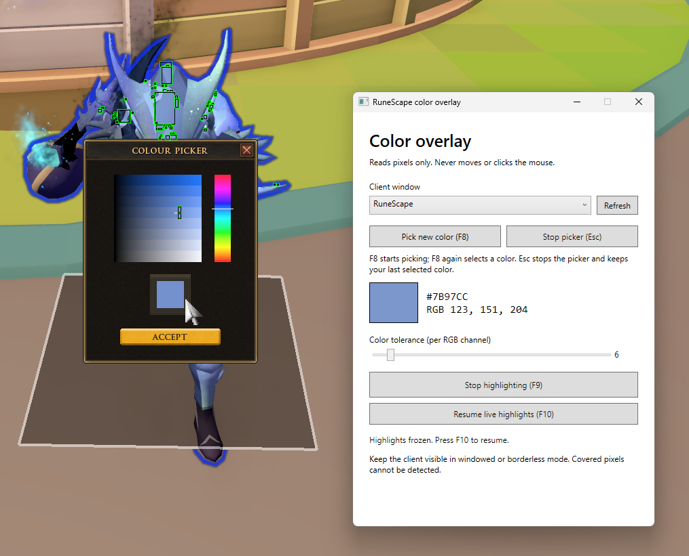

# RuneScape color overlay

A WPF control window and a transparent, click-through overlay. Reads visible
pixels and draws outlines. No mouse movement, click injection, or game automation.

## Example result

Matching color areas in RuneScape are outlined in green. The control window
shows the selected color, its HEX and RGB values, and the matching tolerance.



## Requirements

To run a downloaded release:

- Windows x64, Windows 10 version 2004 (build 19041) or newer, or Windows 11.
- A visible RuneScape/RuneLite client in windowed or borderless mode.
- Download the ZIP from GitHub **Releases**, extract the entire ZIP, and run
  `RSGameOverlayWPF.exe` inside it. Keep all extracted files together.
- Release ZIPs include the .NET runtime; no separate .NET installation is needed.

To build from source:

- Windows with the **.NET SDK 10.0.403** specified in `global.json` (or a newer
  stable SDK allowed by its roll-forward setting). This SDK builds the project's
  `net9.0-windows` target; the SDK version and target framework are separate.
- Internet access for restoring .NET targeting/runtime packs.
- Rider or Visual Studio is optional; the `dotnet` command line is sufficient.
- For `dotnet run` and ordinary framework-dependent builds, install the
  **.NET 9 Desktop Runtime**. Self-contained published builds include that runtime.

## Run locally

Download the Windows x64 ZIP from this repository's **Releases** page, extract
it, and open `RSGameOverlayWPF.exe`. Keep the extracted files together.

To run from source instead, install the SDK and Desktop Runtime listed above,
open a terminal in the project directory, and run:

```powershell
dotnet run --project RSGameOverlayWPF.csproj
```

You can also open `RSGameOverlayWPF.sln` in Rider or Visual Studio and run the
project there.

## Use

1. Open RuneScape in windowed or borderless mode.
2. Select its window in the client list. Refresh if needed.
3. Press **F8** or click **Pick new color** for a live preview beside your pointer. The
   larger swatch shows HEX and RGB values underneath. Move to the desired pixel
   and press **F8** again to select it. No click on the game is required.
4. Click **Start highlighting** or press **F9**.
5. Adjust tolerance. Zero requires an exact RGB match; 12 allows each RGB channel
   to differ by up to 12. The cursor preview and control-window preview retain
   the selected color while you move the pointer. Click **Pick new color** to
   resume live sampling; highlighting pauses until you select with F8.
6. Press **Esc** or click **Stop picker** to hide the cursor preview and stop live
   sampling. The main window retains the last color selected with F8, including
   HEX and RGB. Canceling a new live pick restores that previous selection.
   Highlighting continues if enabled. F8 opens the picker again.
7. Press F9 to stop highlighting. Closing the control window closes the overlay too.

For screenshots, press **F10** to freeze the current highlights, capture with
**Win+Shift+S**, Greenshot, or another screen-capture tool, then press **F10**
again to resume detection. The Freeze highlights button does the same thing.

F8/F9/F10 are global shortcuts while the app runs. If another app has registered
either key, close that app and reopen this one. The shortcuts consume those keys.
Esc is registered only while the cursor preview is active and is released when
the picker stops. If Esc is unavailable, use the Stop picker button.
F8 starts live picking when idle and confirms the selected color while picking.
Selections last for the current application session and reset on restart.
The cursor preview is click-through, stays within the current monitor's work
area, and is excluded from capture so it cannot contaminate color detection.

## Detection

Captures the visible client area approximately every 180 ms, with at most one
background capture/detection job at a time. Matching pixels that touch (including
diagonally) form groups. Each gets a tight rectangular outline around its actual
pixel bounds, plus 2 physical pixels of padding on each side. At client edges,
padding is clipped to the overlay. At most 250 groups are displayed.

The overlay follows client position and size and handles display scaling. It
hides when the client is minimized or unavailable. When any other application
takes focus, detection pauses and existing highlights stay visible; returning to
the client or control window resumes detection unless manually frozen with F10.
Highlights can therefore remain over other applications covering the game;
press F9 to hide them. Detection ignores the control window and
cursor preview wherever they overlap the game. Covered game pixels remain
unavailable until those windows are moved aside.

Highlight borders are visible to desktop screenshot tools. The detector ignores
their painted pixels to prevent the highlights from detecting themselves. Any
game pixels directly covered by a border are also unavailable to detection.

Highlights are not excluded from Windows screen capture, and screenshot support
does not depend on the capturing application's name. F10 prevents a capture
tool's dimming or selection UI from changing the matches, even if the tool does
not take focus. Capture the screen or a region; capturing only the game window
can omit the separate overlay. A capture tool's own settings and capture method
can still affect whether separate layered windows are included.

This is desktop capture: covered game pixels cannot be detected. Keep the control
window beside the game. Use Windows 10 version 2004 or newer for overlay capture
exclusion. Exclusive fullscreen, protected content, HDR, lighting, and
antialiasing can affect results. Start with a visible SDR windowed client.

## Files

- `MainWindow.xaml` / `.cs`: controls, hotkeys, scheduling.
- `OverlayWindow.xaml` / `.cs`: transparent window and highlight drawing.
- `CursorPreviewWindow.cs`: larger cursor swatch, HEX/RGB readout, selected/live state.
- `NativeScreen.cs`: window discovery, capture, RGB matching, overlay positioning.
- `app.manifest`: per-monitor DPI awareness.
